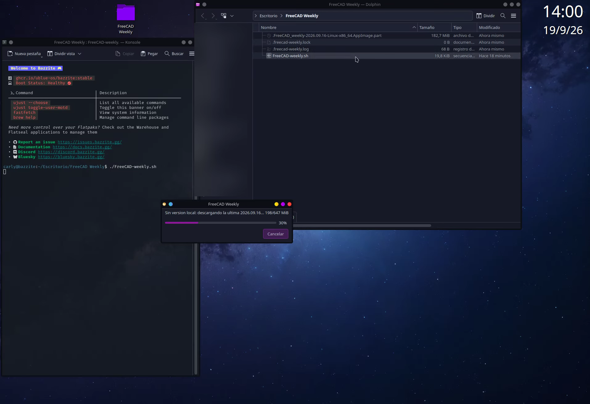

# FreeCAD AutoUpdater Scripts
## FreeCAD Weekly / Stable (scripts todo en uno)
**v0.8.6**

[English](README.md) | **Español**

Dos scripts de shell que **descargan, instalan, actualizan y ejecutan**
AppImage de FreeCAD en Linux, con un solo clic (en `linux/`):

| Script | Canal |
|---|---|
| `linux/FreeCAD-weekly.sh` | Compilaciones de desarrollo (`weekly-YYYY.MM.DD`) |
| `linux/FreeCAD-stable.sh` | Versiones estables (`1.1.4`, `1.2.0`, ...) |

Ambos guardan todo (AppImage, icono, log, marcas y copias de la
configuración) en la misma carpeta que el script, y ambos aplican el
workaround de `libdrm` en sistemas con Mesa reciente **solo cuando hace
falta** (ver abajo). Los dos scripts pueden convivir en la misma carpeta sin
interferirse.

## Requisitos

- Linux x86_64 o aarch64.
- `curl`.
- KDE Plasma recomendado (`kdialog` + `qdbus`) para la ventana de progreso;
  como alternativa funciona `zenity`. Las notificaciones usan `notify-send`.
- FUSE (libfuse2) para ejecutar AppImage.
- `unsquashfs` (squashfs-tools) es opcional y solo lo usa
  `FreeCAD-stable.sh` para inspeccionar el AppImage antes de aplicar el fix
  de libdrm. Sin él, el fix se aplica por precaución (es inocuo).

## Uso rápido

1. Copia `FreeCAD-weekly.sh` (o `FreeCAD-stable.sh`) a una carpeta con
   permiso de escritura (por ejemplo `~/AppImages/FreeCAD/`).
2. Dale permisos de ejecución:
   ```sh
   chmod +x FreeCAD-weekly.sh FreeCAD-stable.sh
   ```
3. Ejecútalo:
   ```sh
   ./FreeCAD-weekly.sh     # compilación de desarrollo
   ./FreeCAD-stable.sh     # versión estable
   ```

La primera vez descargará la última versión de su canal y preguntará si
quieres crear un acceso en el menú de inicio, si además quieres un acceso
directo en el Escritorio y si quieres asociar los archivos `.FCStd` (como buen
portable, no asocia nada salvo que lo pidas).
Las siguientes veces comprobará si hay una versión nueva y arrancará FreeCAD.

Todo (AppImage, icono, log, marcas y copias de la configuración) se guarda
en la misma carpeta que el script.

## Demostración

[](media/demo.mp4)

_Haz clic en la imagen para ver la demostración (MP4, ~85 s)._

## Opciones

Las mismas opciones valen para los dos scripts
(`./FreeCAD-stable.sh --check`, etc.):

| Opción | Efecto |
|---|---|
| (ninguna) | Comprueba/actualiza y ejecuta |
| `--no-update` | Ejecuta sin comprobar actualizaciones |
| `--check` | Solo comprueba si hay versión nueva (no descarga) |
| `--reinstall` | Borra la local y vuelve a descargar la última |
| `--create-shortcut` | Crea el acceso al menú de inicio |
| `--remove-shortcut` | Elimina el acceso del menú de inicio |
| `--create-desktop` | Crea el acceso directo en el Escritorio |
| `--remove-desktop` | Elimina el acceso directo del Escritorio |
| `--associate` | Asocia los archivos `.FCStd` (abrir con doble clic) |
| `--remove-assoc` | Quita la asociación de `.FCStd` |
| `--uninstall` | Desinstala (AppImage, acceso, asociación, icono, log) |
| `-y`, `--yes` | No preguntar (asumir sí) |
| `-v`, `--verbose` | Muestra información adicional |
| `-h`, `--help` | Muestra la ayuda |
| `--` | Todo lo siguiente se pasa a FreeCAD |

Para pasar argumentos a FreeCAD, usa `--`:

```sh
./FreeCAD-weekly.sh -- mi_archivo.FCStd
./FreeCAD-weekly.sh -- --help
```

## Sobre el workaround de libdrm

Algunos AppImage de FreeCAD incluyen su propia `libdrm` (2.4.125). En
sistemas con **Mesa >= 26.2**, el driver del sistema necesita símbolos que esa
libdrm no exporta, y FreeCAD falla al arrancar con `Could not initialize GLX`.

Los scripts solo fuerzan las `libdrm` del sistema con `LD_PRELOAD` cuando ese
problema puede darse de verdad, y cada canal lo decide a su manera:

- **`FreeCAD-weekly.sh`**: la fecha está en el nombre del fichero, así que no
  inspecciona nada. Solo los weeklies **anteriores a `2026.09.30`** reciben el
  fix (desde ese tag el bundle ya no incluye libdrm, gracias a
  [FreeCAD PR #33005](https://github.com/FreeCAD/FreeCAD/pull/33005)), y solo
  si la libdrm del sistema es lo bastante nueva.
- **`FreeCAD-stable.sh`**: inspecciona el propio AppImage
  (`unsquashfs -ll`/`-cat`, sin extraer nada): si el bundle no lleva una
  libdrm activa, o lleva una reciente, no se aplica nada. La decisión se
  cachea junto al AppImage (`.freecad-stable.fix`) y se recalcula con cada
  versión nueva.

Más información: [FreeCAD issue #32061](https://github.com/FreeCAD/FreeCAD/issues/32061).

## Copias de seguridad de la configuración

Antes de cada arranque, cada script guarda una copia con fecha y hora de la
configuración de FreeCAD (`~/.config/FreeCAD`) en la misma carpeta que el
script:

- estable: `.cfg-backup-stable/freecad-cfg-AAAAMMDD-HHMMSS.tar.gz`
- semanal: `.cfg-backup-weekly/freecad-cfg-AAAAMMDD-HHMMSS.tar.gz`

La copia se omite si ya existe una de hace menos de 10 minutos, y solo se
conservan las 3 más recientes. Cada copia queda anotada como
`config backup saved` en `.freecad-stable.log` / `.freecad-weekly.log`.

Para restaurar una copia (con FreeCAD cerrado):

```sh
mv ~/.config/FreeCAD ~/.config/FreeCAD.vieja
tar -xzf .cfg-backup-stable/freecad-cfg-AAAAMMDD-HHMMSS.tar.gz -C ~/.config/
```

(Usa `.cfg-backup-weekly` para el canal semanal.) Si FreeCAD arranca lento o
se cuelga, consulta [TROUBLESHOOTING.md](docs/TROUBLESHOOTING.md).

## Desinstalar

```sh
./FreeCAD-weekly.sh --uninstall
./FreeCAD-stable.sh --uninstall
```

## Versión Windows (experimental)

`win/` contiene los ports a PowerShell de ambos scripts, con las mismas
opciones y semántica: bundle `.7z` portable junto al script, verificación
SHA256, acceso en el menú de inicio (sin admin), asociación opcional de
`.FCStd` (se pregunta al inicio, desactivada por defecto) y
copias de la configuración (en `.zip` en vez de `.tar.gz`). No hay workaround
de libdrm (solo Linux).

1. Copia la carpeta `win/` a una carpeta con permiso de escritura.
2. Haz doble clic en `FreeCAD-stable.cmd` (o `FreeCAD-weekly.cmd`).

Requisitos: Windows 10/11 x86_64, sin dependencias (para extraer el `.7z` usa
`tar.exe`, 7-Zip instalado o descarga automática de `7zr.exe` portable). La
lógica está validada (parser + PSScriptAnalyzer limpios y la suite versionada
`tests/smoke.sh` pasa: 33 comprobaciones con shellcheck, 28 sin él); la
validación de extremo a extremo en un Windows 11 real está en verde (E2E
rápidas 10/0, completas 21/0 por canal). Ver
[PORTABILIDAD.md](docs/PORTABILIDAD.md).

## Versión macOS (experimental)

`mac/` contiene los ports a bash de ambos scripts (ficheros `.command` de
doble clic), con las mismas opciones y semántica: descarga del `.dmg` con
progreso en la Terminal, verificación SHA256, `.app` instalada en
`/Aplicaciones` (`~/Aplicaciones` sin admin), acceso en el Escritorio,
asociación opcional de `.FCStd` (`duti` si está instalado, si no registro
en Abrir con) y
copias de la configuración (`~/Library/Preferences/FreeCAD` a `.tar.gz`).
No hay workaround de libdrm (solo Linux). El nombre del `.dmg` semanal
incluye la versión de macOS, así que se descubre vía la API de GitHub y se
elige la compilación más cercana a tu sistema.

1. Copia la carpeta `mac/` a una carpeta con permiso de escritura.
2. Haz doble clic en `FreeCAD-stable.command` (o `FreeCAD-weekly.command`).

Requisitos: macOS 12+ (Intel o Apple Silicon), sin dependencias (todo lo
usado —`curl`, `shasum`, `hdiutil`, `osascript`— viene de serie). El primer
arranque lo bloqueará macOS (desarrollador no identificado): clic derecho →
*Abrir* → *Abrir*. La lógica está validada (bash + shellcheck limpios y la
suite versionada `tests/smoke.sh` pasa: 33 comprobaciones con shellcheck, 28
sin él); la validación de extremo a extremo en un Mac real sigue pendiente.
Ver [PORTABILIDAD.md](docs/PORTABILIDAD.md).

## Problemas

- Si no arranca, ejecuta `./FreeCAD-weekly.sh --verbose` (o
  `./FreeCAD-stable.sh --verbose`) y revisa `.freecad-weekly.log` /
  `.freecad-stable.log`. El log del estable explica por qué se aplicó (o no)
  el fix de libdrm.
- Para comprobar la versión sin descargar: `./FreeCAD-weekly.sh --check` o
  `./FreeCAD-stable.sh --check`.
- Arranques lentos o cuelgues: consulta [TROUBLESHOOTING.md](docs/TROUBLESHOOTING.md).

## Licencia

Este proyecto se distribuye bajo la licencia MIT. Consulta [LICENSE](LICENSE).

## Contribuir

Consulta [CONTRIBUTING.md](CONTRIBUTING.md). Los cambios se registran en
[CHANGELOG.md](CHANGELOG.md).
